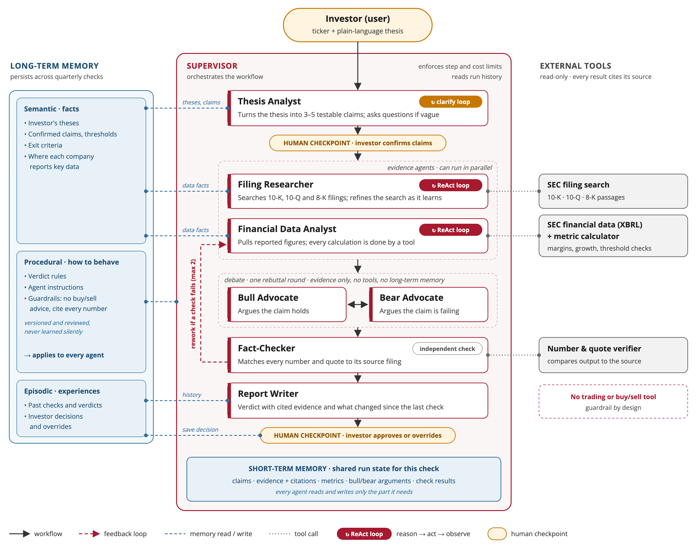

# Thesis Check

**A multi-agent AI that helps investors decide on evidence, not emotion.**

CMU Executive Education, *Agentic AI and Applications*, capstone project by Mohit Sachdeva.

> **Status: v3.1, retrieval design (Module 3).** The design now specifies how the agent retrieves evidence: semantic search over SEC filing text, and exact XBRL lookups for reported numbers. It builds on the v2.1 design of reasoning loops, memory and tools. The code folder still contains the course's single-agent starter template, unmodified; the multi-agent system is built in later versions.

## The problem

Investors are predictably biased: they hold losing stocks too long hoping to break even, sell winners too early to lock in gains (the disposition effect), and seek out information that confirms what they already believe. A key contributor is that the original reason for buying ("margins will expand because of the cloud shift") is rarely written down or re-tested as new evidence arrives in 10-Q and 10-K filings, earnings releases and insider trades. Without an advisor or investment committee to push back, decisions default to emotion.

## Who it's for

Self-directed investors who pick their own stocks but have no one to challenge their decisions. Primary persona: *Priya, 34, a product manager with $120k across 12 stocks, holding a 20% loss "until it gets back to even."* Secondary: professionals with concentrated employer stock (RSUs, ESPP).

## What it will do

Given a ticker and a plain-language thesis, Thesis Check will:

1. Turn the thesis into 3–5 testable claims with KPIs and thresholds.
2. Gather evidence from SEC filings (RAG) and structured XBRL financial data (tools).
3. Run a bounded bull-vs-bear debate between agents to counter confirmation bias.
4. Verify every number and citation with a fact-checker agent.
5. Return a verdict (Intact / Weakening / Broken) with cited evidence for the user to approve, or "Untestable as stated" if the thesis cannot be turned into testable claims.

### System design (Checkpoint 2.1)



| Agent | Role | Reasoning loop | Long-term memory |
|---|---|---|---|
| Supervisor | Runs a fixed workflow, routes work, enforces step and cost limits | No (fixed workflow with bounded loop-backs) | Episodic (read) |
| Thesis Analyst | Turns the thesis into 3–5 testable claims | Light (clarifying questions with the user) | Semantic + episodic |
| Filing Researcher | Finds relevant 10-K / 10-Q / 8-K passages | Yes, full ReAct loop | Semantic (where data lives) |
| Financial Data Analyst | Pulls XBRL figures; all calculations done by tools | Yes, short ReAct loop | Semantic (line-item mappings) |
| Bull Advocate / Bear Advocate | Argue for and against each claim using only gathered evidence | No (one-round structured debate) | None, by design |
| Fact-Checker | Matches every number and quote to its source | No (rule-based checks) | None, by design |
| Report Writer | Produces the verdict and what changed since the last check | No | Episodic (read) |

A human confirms the extracted claims before research starts and approves or overrides the final verdict. A failed fact-check sends a claim back to the evidence agents at most twice. Full reasoning in [Capstone Checkpoint 2.1](docs/Capstone%20Checkpoint%202.1%20-%20Agent%20Design%20Refinement.docx); open questions in [Design Considerations](docs/Design%20Considerations%20-%20Thesis%20Check.md).

### Retrieval design (Checkpoint 3.1)

Retrieval is used for filing text only. Explanations, guidance and new risks are found by semantic search over 10-K, 10-Q and 8-K filings; reported numbers come from exact XBRL lookups, because similarity search can return the right figure from the wrong quarter. Filings are split by section into ~500-token chunks, labeled with company, form, period and section, and stored in Chroma. The Filing Researcher's `search_filings` tool filters by ticker and period before ranking, returns the top 5 passages with citations, and never falls back to older filings on its own. Full reasoning in [Capstone Checkpoint 3.1](docs/Capstone%20Checkpoint%203.1%20-%20Retrieval%20Design.md).

**Planned stack:** Python, LangGraph, an LLM API (Claude or OpenAI), SEC EDGAR APIs, Chroma, SQLite, Pydantic, pytest.

## Repository structure

```text
.
├── README.md
├── docs/
│   ├── Capstone Checkpoint 1.1 - Thesis Check.docx                # Module 1: project scoping and initial design
│   ├── Capstone Checkpoint 2.1 - Agent Design Refinement.docx     # Module 2: reasoning loops, memory, tools
│   ├── Capstone Checkpoint 3.1 - Retrieval Design.md / .docx      # Module 3: retrieval (RAG) design
│   ├── Design Considerations - Thesis Check.md                    # open design decisions to revisit
│   ├── STP and Positioning - Thesis Check.md                      # segmentation, targeting, positioning, persona
│   ├── Self-study Capstone Checkpoint Activity 7.1_...docx        # capstone report plan
│   └── images/thesis-check-system-design.png                      # system design diagram
└── code/                                                      # CMU Research Agent starter template (baseline)
    ├── research_agent/
    ├── tests/
    └── requirements.txt
```

## Running the baseline (starter template)

```bash
cd code
python -m venv .venv && source .venv/bin/activate
python -m pip install -r requirements.txt
python -m research_agent.cli "Impact of AI on healthcare" --max-sources 8 --output report.md
python -m pytest tests -q
```

The single-agent starter is kept as the **baseline** the multi-agent system will be evaluated against.

## Roadmap

- **v1.0 / v1.1**: problem definition, users, positioning, draft architecture (Checkpoint 1.1)
- **v2.1**: agent design refinement: reasoning loops, memory, tools, system diagram (Checkpoint 2.1)
- **v3.1**: retrieval design: semantic search over SEC filings, chunking, top-k, wrong-period failure mode (Checkpoint 3.1) *(this version)*
- **Next**: SEC EDGAR data client, filing ingest and `search_filings` retrieval tool, financial tools; single ReAct Filing Researcher (first upgrade over the baseline)
- **Then**: multi-agent supervisor graph
- **Then**: bull/bear debate, fact-checker, human-in-the-loop
- **Then**: memory across runs, evaluation harness (golden set, numeric accuracy, baseline comparison), guardrails

## Disclaimer

Thesis Check is an educational project and decision-support tool. It does not provide financial advice or buy/sell recommendations.

## Credits

The `code/` baseline is the CMU *Agentic AI and Applications* Research Agent starter template.
