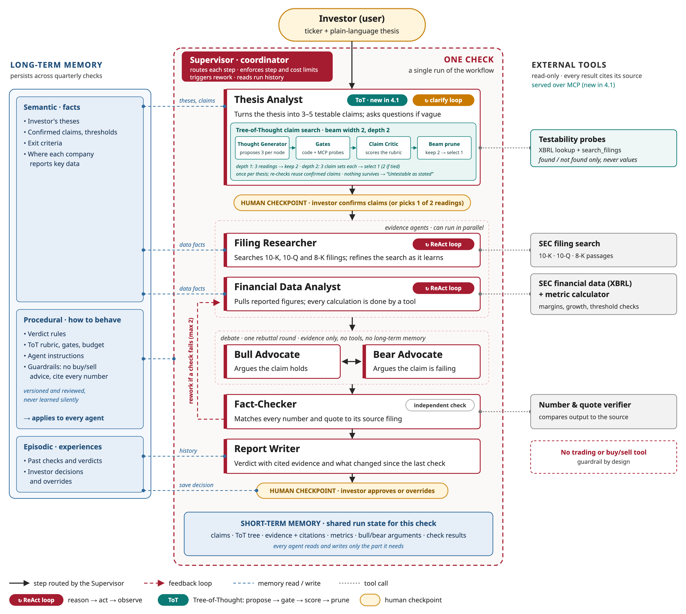

# Capstone Checkpoint 4.1: Tree-of-Thought Reasoning

**Thesis Check: Choosing the Right Claims Before Testing Them**

Mohit Sachdeva | Agentic AI Program | October 2026

## 1. Is ToT appropriate?

Yes, in one step only: when the Thesis Analyst turns the investor's thesis into testable claims. Everywhere else, ToT would add cost without improving accuracy.

- **Rule:** explore alternatives only where (1) an early wrong choice is expensive, (2) no later step can catch it, and (3) candidates can be scored cheaply before committing.
- Claim decomposition is the only step that meets all three.

| Step | ToT? | Why |
|---|---|---|
| Thesis Analyst: claim decomposition | **Yes** | Every later step inherits the claims; nothing sends them back |
| Filing Researcher, Financial Data Analyst | No | ReAct already adapts to each search result; a miss ends as "insufficient evidence" |
| Bull and Bear Advocates | No | Searching for the most persuasive argument rewards rhetoric, not truth |
| Fact-Checker | No | A number matches its source or it doesn't |
| Supervisor and verdict rubric | No | The same filing must give the same verdict, at a bounded cost |

## 2. Where ToT is used, and why a linear chain fails

- ToT runs inside the Thesis Analyst, after the investor enters a thesis and before they confirm the claims (Figure 1).
- It picks the best set of 3–5 testable claims.
- It runs once per thesis. Quarterly re-checks reuse the confirmed claims.

*Figure 1. Thesis Check system design, with ToT claim search inside the Thesis Analyst.*

Take Priya's thesis: "AI demand will keep gross margins above 60%." A linear chain of thought fails in three ways:

- **Premature commitment.** It fixes the meaning of "keep" in its first step. If it reads "keep" as last quarter's margin, it never adds a claim on management's outlook, so the claims can pass even after guidance drops below 60%. No later step catches this: the Fact-Checker checks evidence, not the choice of claims, and rework goes to the evidence agents. The investor confirming the claims is the person whose bias the product exists to counter.
- **High branching.** "AI demand," "margins" and "keep" each have several valid meanings, giving roughly 30 combinations.
- **Constraint complexity.** A valid claim set must satisfy six rules at once, and a linear chain finds violations only after the research budget is spent:
  - 3–5 claims
  - each testable from *this company's* SEC data
  - no price-based claims
  - the investor's numbers unchanged
  - no duplicate measures
  - at least one claim that could fail

## 3. ToT structure

| Element | Definition |
|---|---|
| Thought | One decision about making the thesis testable: how to read it, or how to measure it |
| Node (reasoning state) | The root plus the thoughts on its path, stored as an immutable record |
| Root | Thesis, ticker, clarifying answers, and the thresholds the investor stated |
| Depth 1 | A **reading**: the thesis as a cause-and-effect chain, e.g., AI demand → data-center sales → richer mix → gross margin ≥ 60% |
| Depth 2 (leaf) | A **claim set**: 3–5 claims, each with a metric, threshold, period and source |
| Branch | An alternative reading, or an alternative claim set for the same reading |
| Branching factor | 3 children per node; the beam keeps 2 readings, so at most 9 nodes |
| Depth limit | 2: a leaf is a complete claim set |

**Termination:**

- The search stops when the depth-2 claim sets are scored. The top-scoring set goes to the investor for confirmation.
- It stops early if the budget runs out (it then shows the best set so far) or if no candidate survives (Section 5).

## 4. Search strategy: beam search, width 2

- Compares readings side by side and drops weak ones before spending calls on them.
- Has a fixed, predictable cost.
- Width 2 keeps a backup reading in case the critic misjudges the first.
- The generator proposes 3 distinct siblings in one call at temperature 0, so the same thesis gives nearly the same tree.

| Strategy | Compute | Latency | Complexity | Verdict |
|---|---|---|---|---|
| **Beam (chosen)** | Fixed: 9 nodes, 12 LLM calls | 4 rounds, parallel within a level | Low: keep the top 2 per level | Best balance |
| BFS | 16 calls, grows with every reading | 4 rounds | Lowest | Expands readings already known to be weak |
| DFS | 6 to 16 calls, unpredictable | Up to 8 rounds | Medium: backtracking and a stop rule | Commits to the first reading: the failure ToT fixes |
| Monte Carlo | Dozens of rollouts | Many sequential rounds | High: rollouts and value backup | Built for deep trees; adds variance here |

**Budget:**

- At most 14 LLM calls, 20 tool probes and about 30k tokens.
- Target latency is under 20 seconds.
- ToT stays only if it beats a single linear decomposition on the golden test set.

## 5. Evaluation and pruning

**Who evaluates.** The evaluator sits inside the Thesis Analyst and has two parts:

- **Gates**: code and tool checks.
- **Claim Critic**: a separate LLM prompt at temperature 0.

A deterministic decision maker then applies the thresholds below.

| Gate | Check | Done by |
|---|---|---|
| Well-formed | Metric, threshold, period and source present | Pydantic schema |
| No price claims | No stock price, valuation multiple or price target | Rule check |
| Numbers kept | The investor's thresholds appear unchanged | Code |
| Testable | The XBRL concept has values for the needed periods, or `search_filings` finds a passage for that period | Tool probes |

- Probes return only "found" or "not found," never values. Otherwise the search could pick claims whose result it already knows.

| Criterion | Weight | Scores 5 when |
|---|---|---|
| Faithful | 30% | It tests the belief as stated, with the investor's metric and time frame |
| Covers the chain | 25% | Every link from driver to outcome has a claim |
| Could fail | 25% | At least one claim could fail on the next filing (a check against bias) |
| Distinct | 10% | No two claims measure the same thing |
| Clear | 10% | The investor can confirm it in one read |

- The critic scores each criterion from 1 to 5. Readings at depth 1 are scored on Faithful (60%) and Covers the chain (40%).
- It sees only the thesis and one candidate. It never sees the generator's reasoning, the other candidates or the investor's past edits.

**Pruning:**

- A claim that fails a gate is dropped.
- Depth 1: a reading is pruned if it is price-based or scores Faithful < 3. The top 2 survivors move on.
- Depth 2: a claim set is pruned if fewer than 3 claims remain, its outcome claim is lost, it scores Faithful < 3, or its total score is below 3.5.
- If nothing survives, the analyst asks one clarifying question and reruns once. If nothing survives again, the result is "Untestable as stated."
- If the critic's output is invalid twice, the system falls back to one linear decomposition through the same gates.

**Ties (scores within 0.25):**

- **Different readings:** the investor picks one of the two at the confirmation step.
- **Same reading:** a fixed order decides: more claims backed by XBRL data, then a higher "Could fail" score, then fewer claims.

## 6. ToT in action

*(Illustrative; scores are hypothetical.)*

- **Linear chain:** "gross margin above 60% last quarter; revenue growing; management positive on AI." It misses guidance, and its third claim can't fail. It says Intact even when guidance falls to 58%.
- **ToT:**
  - Keeps two readings: mix shift (4.6) and pricing power (4.4).
  - Prunes "guidance only" (3.0).
  - Drops an "AI accelerator revenue" claim, which isn't reported, and a stock-price claim, which fails a gate.
- **Selected set (4.55):** data-center growth, gross margin ≥ 60% and next-quarter outlook ≥ 60%. The outlook claim comes back Broken.

## 7. Mapping ToT roles to tools

| Role | LangChain / LangGraph | MCP | CrewAI (evaluated) |
|---|---|---|---|
| Thought Generator | **Used.** An LCEL chain with Pydantic output, run from a LangGraph node | **Used.** Reads confirmed claims and past edits from the thesis store | Could be an `Agent`; not needed |
| Critic / evaluator | **Used.** A separate LCEL chain for scores; gates as Python | **Used.** XBRL and `search_filings` probes, shared with the evidence agents | Could be an `Agent`; shared crew memory would break the critic's isolation |
| Decision maker | **Used.** A LangGraph subgraph: generate → gate → score → prune, with budget counters and the confirmation interrupt | Not used | Not suitable: a manager LLM would choose the next step |
| State manager | **Used.** Immutable nodes in LangGraph state, with a SQLite checkpointer | **Used.** The thesis store keeps confirmed claims for re-checks | Not used: it would duplicate state |

**Why not CrewAI:**

- Its strengths are delegation between agents and a manager LLM that routes work. Thesis Check's fixed workflow rules out both.
- Role separation already comes from LangGraph nodes with separate prompts and scoped state.
- Revisit CrewAI if defining all eight agents in LangGraph proves clumsy.

## 8. Risk and mitigation

**Risk: weak evaluation signals prune the best branch too early.**

- Beam cuts are final.
- The critic infers what the investor meant from one sentence, and may prefer the most common or most fluent reading.

**Mitigation: the critic ranks but rarely cuts, and is calibrated first.**

- Only objective checks cut outright: the gates and clear misreadings (Faithful < 3).
- A beam width of 2 keeps a backup reading, and near-ties go to the investor.
- Before go-live, ToT is calibrated on about 20 golden theses: the reference reading must survive depth 1 at least 90% of the time.
- Every pruned branch is logged with its score and reason.

## 9. Project repository

Repository: [https://github.com/mosachde/agentic-ai-real-world-capstone-work](https://github.com/mosachde/agentic-ai-real-world-capstone-work)

This checkpoint: [https://github.com/mosachde/agentic-ai-real-world-capstone-work/tree/checkpoint-4.1/docs](https://github.com/mosachde/agentic-ai-real-world-capstone-work/tree/checkpoint-4.1/docs)
