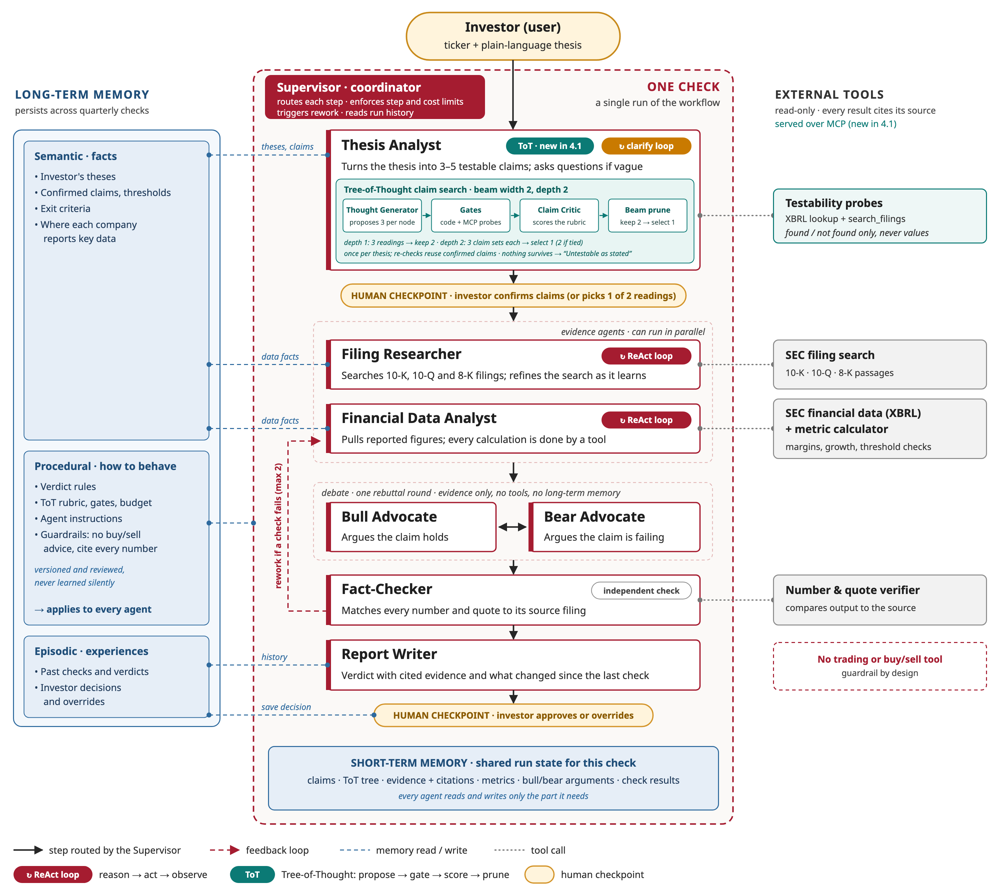

# Capstone Checkpoint 5.1: Multi-Agent Design

**Thesis Check: A Team of Agents That Tests an Investor's Thesis**

Mohit Sachdeva | Agentic AI Program | November 2026

## 1. The problem, and why one agent is not enough

Investors rarely re-test why they own a stock, and they tend to look for information that agrees with them. Thesis Check takes a ticker and the investor's reason for owning it. It then returns a verdict (Intact, Weakening or Broken), with evidence from SEC filings.

One agent can't do this job well:

- **The work is of different kinds.** It means turning a belief into testable claims, searching 100-page filings, pulling exact numbers, arguing both sides, checking facts and writing a report. A single agent mixes these jobs up, and long filings overload it.
- **A single agent tends to agree with the user.** That is the bias the product exists to fight. Separate Bull and Bear agents make sure the other side is always argued.
- **An agent can't reliably check its own work.** An independent Fact-Checker, separate from the agents that gathered the evidence, is a real check.
- **Each agent gets only what it needs.** With separate roles, each agent gets only the tools and memory its job requires. For example, the Bull and Bear get no tools, so they can't bring in unchecked facts.

The design copies how a professional investment committee works: an analyst, researchers, a devil's advocate and a compliance check.

## 2. How many agents, and why

Thesis Check has **eight agents**: one coordinator and seven specialists. I chose the number with three rules:

- **Split when a job needs different tools or must stay independent.** Bull and Bear must not share reasoning. The Fact-Checker must not be the agent that found the evidence. Searching filing text and pulling exact numbers use different tools and fail in different ways, so they are separate agents.
- **Merge when splitting only adds handoffs.** The Thesis Analyst both drafts and refines the claims. Its idea generator and critic (Checkpoint 4.1) are steps inside it, not separate agents.
- **Stop when another agent adds cost but no accuracy.** I rejected these extra agents:
  - **A news agent:** opinions feed the bias.
  - **A separate planner:** the Supervisor's fixed workflow already plans.
  - **A "judge" agent for the verdict:** fixed rules decide it, so the same evidence always gives the same verdict.

## 3. Agent roles and responsibilities

| Agent | Responsibility | Tools | Output |
|---|---|---|---|
| Supervisor (coordinator) | Runs the fixed workflow, gives each agent its part of the run state, enforces step and cost limits, sends work back for rework | Run-history store | The next step, and the limits |
| Thesis Analyst | Turns the thesis into 3–5 testable claims; asks clarifying questions | Thesis store; checks that each claim can be tested | Claims for the investor to confirm |
| Filing Researcher | Finds relevant passages in 10-K, 10-Q and 8-K filings, refining its search as it learns | `search_filings` | Passages with citations |
| Financial Data Analyst | Pulls exact reported figures and computes metrics | SEC financial data lookup, metric calculator | Figures and calculations with sources |
| Bull Advocate | Argues each claim still holds, using only the gathered evidence | None | A cited argument |
| Bear Advocate | Argues each claim is failing, using only the gathered evidence | None | A cited argument |
| Fact-Checker | Checks every number and quote against its source and period | Number and quote verifier | Pass or fail for each item |
| Report Writer | Writes the verdict, the evidence and what changed since the last check | Run history | The report for the investor |

Two steps are deliberately not agents:

- **The verdict** comes from fixed rules in code.
- **The investor** confirms the claims and approves or overrides the verdict.

*Figure 1. Thesis Check system design.*

## 4. Coordination strategy: hybrid

The workflow is a **sequential backbone with parallel steps and short, capped loops**. It is built as a LangGraph graph with fixed paths.

- **Sequential where steps depend on each other.** The order is claims → evidence → debate → fact-check → report, like an assembly line. Each step needs the previous step's output.
- **Parallel where they don't.** The Filing Researcher and Financial Data Analyst work at the same time, and each claim can be researched on its own.
- **Iterative inside some agents.** The two evidence agents run a search–read–decide loop (ReAct). The Thesis Analyst compares a few candidate claim sets before picking one.
- **Capped loops back:**
  - If a fact-check fails, the claim goes back to the evidence agents, at most twice.
  - The Bull or Bear may ask for more evidence once per claim. That request counts toward the same limit of two.
  - If the investor edits the claims, they go back to the Thesis Analyst.

I didn't let agents call each other freely, for two reasons:

- Cost and behavior would be hard to predict or audit.
- An advocate could keep asking for evidence until it found support for its side.

## 5. Communication between agents

- **A shared run state, handed out in pieces.** Agents write their results, in a fixed format, into one shared run state. The Supervisor gives each agent only the part it needs. Most handoffs are one-way, which keeps them fast and simple.
- **Every piece of evidence carries its citation** (filing, section, period), so later agents and the investor can trace it.
- **Two-way exchanges only where checking matters:**
  - The Fact-Checker sends a rework request, with the reason, back to the evidence agents.
  - The Bull and Bear get one rebuttal round each.
  - The investor answers the Thesis Analyst's clarifying questions and confirms the claims.
- **Exploring options in one place only.** The Thesis Analyst considers several ways to test the thesis before choosing one (Checkpoint 4.1).
- **Deliberate isolation:**
  - The Bull and Bear never see past verdicts, so old results can't sway them.
  - The Fact-Checker keeps no memory between runs, so every check is independent.
  - Facts the system learns, such as where a company reports a figure, are saved only after the Fact-Checker has verified them.

## 6. Trade-offs

| Choice | What it gains | What it costs |
|---|---|---|
| Fixed workflow, not routing chosen by an LLM | Predictable cost; every run can be traced step by step | Less flexible for unusual theses |
| Fact-check and rework loop | No unverified number reaches the investor | More time and calls; capped at two loops |
| Bull and Bear debate | Counters confirmation bias | Extra calls per claim; one round only, and unresolved disagreement lowers confidence instead of adding rounds |
| Eight agents, not fewer | Clear roles, each agent limited to what it needs, independent checks | More handoffs; kept manageable by the shared state and fixed formats |
| Evidence agents in parallel | Faster runs | Results must be merged before the debate |
| Two human checkpoints | The investor stays in control | Slower; kept to two touchpoints |

A full run costs more and takes longer than one prompt. That is worth it here because one wrong number can drive a costly decision. A simple question, such as "what is gross margin?", doesn't need the system.

## 7. Effective and scalable problem solving

**Effective:** each weakness of a single agent has a clear owner.

| Weakness | Owner |
|---|---|
| Out-of-date knowledge | The two evidence agents, which read the latest filings |
| Invented numbers | Tools and the Fact-Checker |
| Agreeing with the user | Bull and Bear |
| Inconsistent answers | Fixed verdict rules |

**Scalable:**

- **More claims:** more claims add parallel work, not new agents.
- **New sources:** a new evidence source, such as earnings-call transcripts or insider trades, can be added as a tool or one new evidence agent without changing the others.
- **Re-checks:** quarterly re-checks reuse the confirmed claims and saved facts, and process only new filings.
- **Any ticker:** the same agents work for any US-listed company. Downloading and indexing filings is plain code, not an agent.

**Measurable:** every step is logged, so the system can be compared with the course's single-agent starter on correct numbers, correct citations and matching verdicts.

## 8. Project repository

Repository: [https://github.com/mosachde/agentic-ai-real-world-capstone-work](https://github.com/mosachde/agentic-ai-real-world-capstone-work)

This checkpoint: [https://github.com/mosachde/agentic-ai-real-world-capstone-work/tree/checkpoint-5.1/docs](https://github.com/mosachde/agentic-ai-real-world-capstone-work/tree/checkpoint-5.1/docs)
